# Schema docs

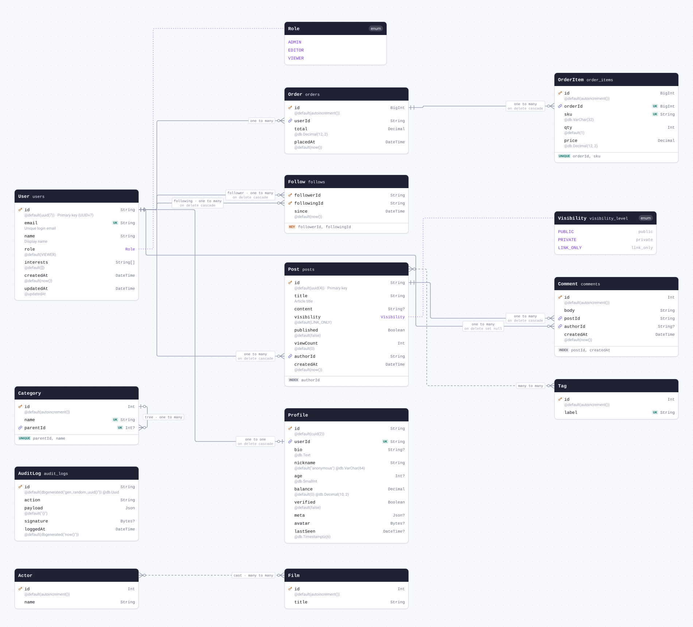

<details>
<summary>The whole schema as SQL</summary>

```sql
CREATE SCHEMA IF NOT EXISTS "public";

CREATE TYPE "Role" AS ENUM ('ADMIN', 'EDITOR', 'VIEWER');

CREATE TYPE "visibility_level" AS ENUM ('public', 'private', 'link_only');

CREATE TABLE "users" (
    "id" TEXT NOT NULL,
    "email" TEXT NOT NULL,
    "name" TEXT NOT NULL,
    "role" "Role" NOT NULL DEFAULT 'VIEWER',
    "interests" TEXT[] DEFAULT ARRAY[]::TEXT[],
    "created_at" TIMESTAMP(3) NOT NULL DEFAULT CURRENT_TIMESTAMP,
    "updated_at" TIMESTAMP(3) NOT NULL,

    CONSTRAINT "users_pkey" PRIMARY KEY ("id")
);

CREATE TABLE "Profile" (
    "id" TEXT NOT NULL,
    "user_id" TEXT NOT NULL,
    "bio" TEXT,
    "nickname" VARCHAR(64) NOT NULL DEFAULT 'anonymous',
    "age" SMALLINT,
    "balance" DECIMAL(10,2) NOT NULL DEFAULT 0,
    "verified" BOOLEAN NOT NULL DEFAULT false,
    "meta" JSONB,
    "avatar" BYTEA,
    "last_seen" TIMESTAMPTZ(6),

    CONSTRAINT "Profile_pkey" PRIMARY KEY ("id")
);

CREATE TABLE "posts" (
    "id" TEXT NOT NULL,
    "title" TEXT NOT NULL,
    "content" TEXT,
    "visibility" "visibility_level" NOT NULL DEFAULT 'link_only',
    "published" BOOLEAN NOT NULL DEFAULT false,
    "view_count" INTEGER NOT NULL DEFAULT 0,
    "author_id" TEXT NOT NULL,
    "created_at" TIMESTAMP(3) NOT NULL DEFAULT CURRENT_TIMESTAMP,

    CONSTRAINT "posts_pkey" PRIMARY KEY ("id")
);

CREATE TABLE "Tag" (
    "id" SERIAL NOT NULL,
    "label" TEXT NOT NULL,

    CONSTRAINT "Tag_pkey" PRIMARY KEY ("id")
);

CREATE TABLE "comments" (
    "id" SERIAL NOT NULL,
    "body" TEXT NOT NULL,
    "post_id" TEXT NOT NULL,
    "author_id" TEXT,
    "created_at" TIMESTAMP(3) NOT NULL DEFAULT CURRENT_TIMESTAMP,

    CONSTRAINT "comments_pkey" PRIMARY KEY ("id")
);

CREATE TABLE "follows" (
    "follower_id" TEXT NOT NULL,
    "following_id" TEXT NOT NULL,
    "since" TIMESTAMP(3) NOT NULL DEFAULT CURRENT_TIMESTAMP,

    CONSTRAINT "follows_pkey" PRIMARY KEY ("follower_id","following_id")
);

CREATE TABLE "Category" (
    "id" SERIAL NOT NULL,
    "name" TEXT NOT NULL,
    "parent_id" INTEGER,

    CONSTRAINT "Category_pkey" PRIMARY KEY ("id")
);

CREATE TABLE "orders" (
    "id" BIGSERIAL NOT NULL,
    "user_id" TEXT NOT NULL,
    "total" DECIMAL(12,2) NOT NULL,
    "placed_at" TIMESTAMP(3) NOT NULL DEFAULT CURRENT_TIMESTAMP,

    CONSTRAINT "orders_pkey" PRIMARY KEY ("id")
);

CREATE TABLE "order_items" (
    "id" BIGSERIAL NOT NULL,
    "order_id" BIGINT NOT NULL,
    "sku" VARCHAR(32) NOT NULL,
    "qty" INTEGER NOT NULL DEFAULT 1,
    "price" DECIMAL(12,2) NOT NULL,

    CONSTRAINT "order_items_pkey" PRIMARY KEY ("id")
);

CREATE TABLE "audit_logs" (
    "id" UUID NOT NULL DEFAULT gen_random_uuid(),
    "action" TEXT NOT NULL,
    "payload" JSONB NOT NULL DEFAULT '{}',
    "signature" BYTEA,
    "logged_at" TIMESTAMP(3) NOT NULL DEFAULT now(),

    CONSTRAINT "audit_logs_pkey" PRIMARY KEY ("id")
);

CREATE TABLE "Actor" (
    "id" SERIAL NOT NULL,
    "name" TEXT NOT NULL,

    CONSTRAINT "Actor_pkey" PRIMARY KEY ("id")
);

CREATE TABLE "Film" (
    "id" SERIAL NOT NULL,
    "title" TEXT NOT NULL,

    CONSTRAINT "Film_pkey" PRIMARY KEY ("id")
);

CREATE TABLE "_PostToTag" (
    "A" TEXT NOT NULL,
    "B" INTEGER NOT NULL,

    CONSTRAINT "_PostToTag_AB_pkey" PRIMARY KEY ("A","B")
);

CREATE TABLE "_cast" (
    "A" INTEGER NOT NULL,
    "B" INTEGER NOT NULL,

    CONSTRAINT "_cast_AB_pkey" PRIMARY KEY ("A","B")
);

CREATE UNIQUE INDEX "users_email_key" ON "users"("email");

CREATE UNIQUE INDEX "Profile_user_id_key" ON "Profile"("user_id");

CREATE INDEX "posts_author_id_idx" ON "posts"("author_id");

CREATE UNIQUE INDEX "Tag_label_key" ON "Tag"("label");

CREATE INDEX "comments_post_id_created_at_idx" ON "comments"("post_id", "created_at");

CREATE UNIQUE INDEX "Category_parent_id_name_key" ON "Category"("parent_id", "name");

CREATE UNIQUE INDEX "order_items_order_id_sku_key" ON "order_items"("order_id", "sku");

CREATE INDEX "_PostToTag_B_index" ON "_PostToTag"("B");

CREATE INDEX "_cast_B_index" ON "_cast"("B");

ALTER TABLE "Profile" ADD CONSTRAINT "Profile_user_id_fkey" FOREIGN KEY ("user_id") REFERENCES "users"("id") ON DELETE CASCADE ON UPDATE CASCADE;

ALTER TABLE "posts" ADD CONSTRAINT "posts_author_id_fkey" FOREIGN KEY ("author_id") REFERENCES "users"("id") ON DELETE CASCADE ON UPDATE CASCADE;

ALTER TABLE "comments" ADD CONSTRAINT "comments_post_id_fkey" FOREIGN KEY ("post_id") REFERENCES "posts"("id") ON DELETE CASCADE ON UPDATE CASCADE;

ALTER TABLE "comments" ADD CONSTRAINT "comments_author_id_fkey" FOREIGN KEY ("author_id") REFERENCES "users"("id") ON DELETE SET NULL ON UPDATE CASCADE;

ALTER TABLE "follows" ADD CONSTRAINT "follows_follower_id_fkey" FOREIGN KEY ("follower_id") REFERENCES "users"("id") ON DELETE CASCADE ON UPDATE CASCADE;

ALTER TABLE "follows" ADD CONSTRAINT "follows_following_id_fkey" FOREIGN KEY ("following_id") REFERENCES "users"("id") ON DELETE CASCADE ON UPDATE CASCADE;

ALTER TABLE "Category" ADD CONSTRAINT "Category_parent_id_fkey" FOREIGN KEY ("parent_id") REFERENCES "Category"("id") ON DELETE SET NULL ON UPDATE CASCADE;

ALTER TABLE "orders" ADD CONSTRAINT "orders_user_id_fkey" FOREIGN KEY ("user_id") REFERENCES "users"("id") ON DELETE RESTRICT ON UPDATE CASCADE;

ALTER TABLE "order_items" ADD CONSTRAINT "order_items_order_id_fkey" FOREIGN KEY ("order_id") REFERENCES "orders"("id") ON DELETE CASCADE ON UPDATE CASCADE;

ALTER TABLE "_PostToTag" ADD CONSTRAINT "_PostToTag_A_fkey" FOREIGN KEY ("A") REFERENCES "posts"("id") ON DELETE CASCADE ON UPDATE CASCADE;

ALTER TABLE "_PostToTag" ADD CONSTRAINT "_PostToTag_B_fkey" FOREIGN KEY ("B") REFERENCES "Tag"("id") ON DELETE CASCADE ON UPDATE CASCADE;

ALTER TABLE "_cast" ADD CONSTRAINT "_cast_A_fkey" FOREIGN KEY ("A") REFERENCES "Actor"("id") ON DELETE CASCADE ON UPDATE CASCADE;

ALTER TABLE "_cast" ADD CONSTRAINT "_cast_B_fkey" FOREIGN KEY ("B") REFERENCES "Film"("id") ON DELETE CASCADE ON UPDATE CASCADE;
```

</details>

## Contents

| Model                         | Table         | Description                                                                                                                                                                             |
| ----------------------------- | ------------- | --------------------------------------------------------------------------------------------------------------------------------------------------------------------------------------- |
| [User](#model-User)           | `users`       | Application user. Fully annotated for every validator generator, with a UUIDv7 primary key, enum default, scalar list, @map columns, @updatedAt, and relations of every cardinality.    |
| [Profile](#model-Profile)     | `Profile`     | One-to-one relation with native @db.* types, literal defaults, and optional scalars of every flavour. ConfigDict passthrough: the Pydantic model rejects unknown keys (extra='forbid'). |
| [Post](#model-Post)           | `posts`       | @@map + @map column names, FK with a referential action, mapped-enum default, and an implicit many-to-many to Tag.                                                                      |
| [Tag](#model-Tag)             | `Tag`         | Implicit many-to-many partner of Post (join table `_PostToTag`).                                                                                                                        |
| [Comment](#model-Comment)     | `comments`    | Two foreign keys with different referential actions (Cascade vs SetNull) and a composite index.                                                                                         |
| [Follow](#model-Follow)       | `follows`     | Composite primary key + two named relations to the same model.                                                                                                                          |
| [Category](#model-Category)   | `Category`    | Self-relation (adjacency-list tree) with a composite unique.                                                                                                                            |
| [Order](#model-Order)         | `orders`      | BigInt autoincrement primary key (bigserial) and money as Decimal.                                                                                                                      |
| [OrderItem](#model-OrderItem) | `order_items` | Child of Order with a composite unique constraint.                                                                                                                                      |
| [AuditLog](#model-AuditLog)   | `audit_logs`  | DB-side generated defaults (dbgenerated) plus Json / Bytes payloads.                                                                                                                    |
| [Actor](#model-Actor)         | `Actor`       | Named implicit many-to-many: the join table is `_cast`, not `_ActorToFilm`.                                                                                                             |
| [Film](#model-Film)           | `Film`        |                                                                                                                                                                                         |

| Enum                           | Name in the database | Description                                                                                                                                                                     |
| ------------------------------ | -------------------- | ------------------------------------------------------------------------------------------------------------------------------------------------------------------------------- |
| [Role](#enum-Role)             | `Role`               | User role. No @map: the value names are stored verbatim.                                                                                                                        |
| [Visibility](#enum-Visibility) | `visibility_level`   | Enum with @map on every value and @@map on the enum itself: the database stores the mapped values ("link_only"), while generators receive the Prisma-level names ("LINK_ONLY"). |

## Models

<a id="model-User"></a>

### User

Table `users`. Application user. Fully annotated for every validator generator,
with a UUIDv7 primary key, enum default, scalar list, @map columns,
@updatedAt, and relations of every cardinality.

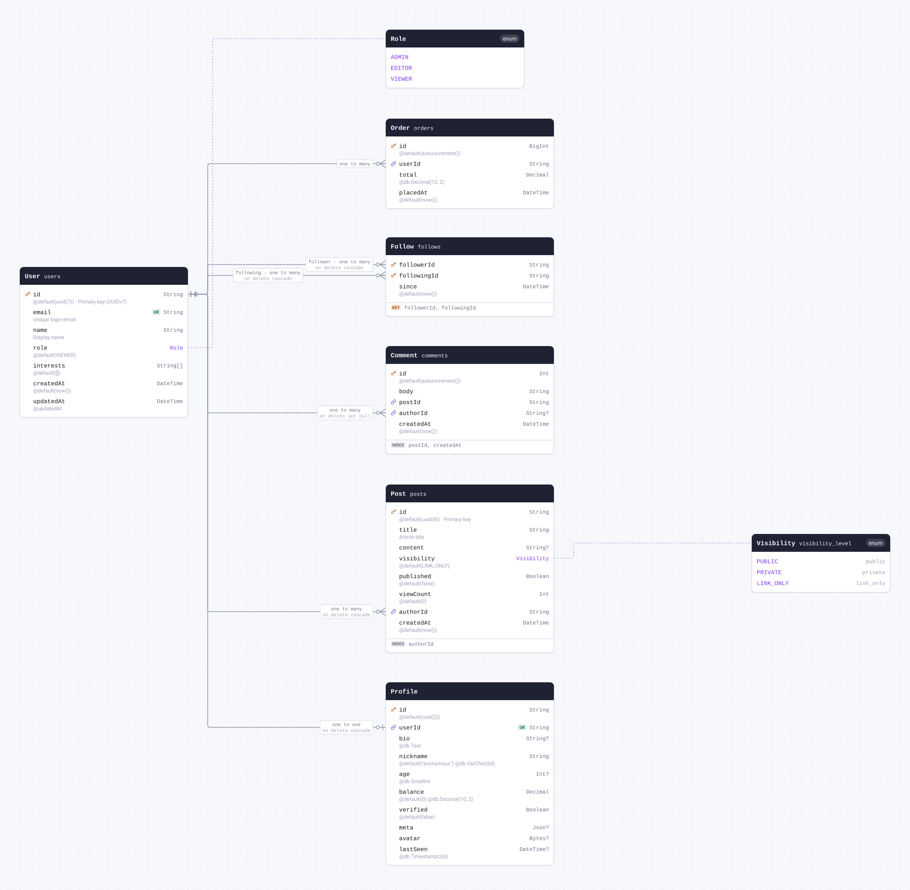

| Field                      | Type                 | Constraints     | Default      | Description          |
| -------------------------- | -------------------- | --------------- | ------------ | -------------------- |
| `id`                       | `String`             | PK NOT NULL     | `uuid(7)`    | Primary key (UUIDv7) |
| `email`                    | `String`             | UNIQUE NOT NULL |              | Unique login email   |
| `name`                     | `String`             | NOT NULL        |              | Display name         |
| `role`                     | [`Role`](#enum-Role) | NOT NULL        | `VIEWER`     |                      |
| `interests`                | `String[]`           | NOT NULL        | `[]`         |                      |
| `createdAt` (`created_at`) | `DateTime`           | NOT NULL        | `now()`      |                      |
| `updatedAt` (`updated_at`) | `DateTime`           | NOT NULL        | `@updatedAt` |                      |

#### Referenced by

- `id` ← [Profile.userId](#model-Profile) (one-to-one, on delete Cascade)
- `id` ← [Post.authorId](#model-Post) (one-to-many, on delete Cascade)
- `id` ← [Comment.authorId](#model-Comment) (one-to-many, on delete SetNull)
- `id` ← [Follow.followerId](#model-Follow) (one-to-many, on delete Cascade)
- `id` ← [Follow.followingId](#model-Follow) (one-to-many, on delete Cascade)
- `id` ← [Order.userId](#model-Order) (one-to-many)

#### Definition

```sql
CREATE TABLE "users" (
    "id" TEXT NOT NULL,
    "email" TEXT NOT NULL,
    "name" TEXT NOT NULL,
    "role" "Role" NOT NULL DEFAULT 'VIEWER',
    "interests" TEXT[] DEFAULT ARRAY[]::TEXT[],
    "created_at" TIMESTAMP(3) NOT NULL DEFAULT CURRENT_TIMESTAMP,
    "updated_at" TIMESTAMP(3) NOT NULL,

    CONSTRAINT "users_pkey" PRIMARY KEY ("id")
);

CREATE UNIQUE INDEX "users_email_key" ON "users"("email");
```

<a id="model-Profile"></a>

### Profile

One-to-one relation with native @db.* types, literal defaults,
and optional scalars of every flavour. ConfigDict passthrough: the
Pydantic model rejects unknown keys (extra='forbid').

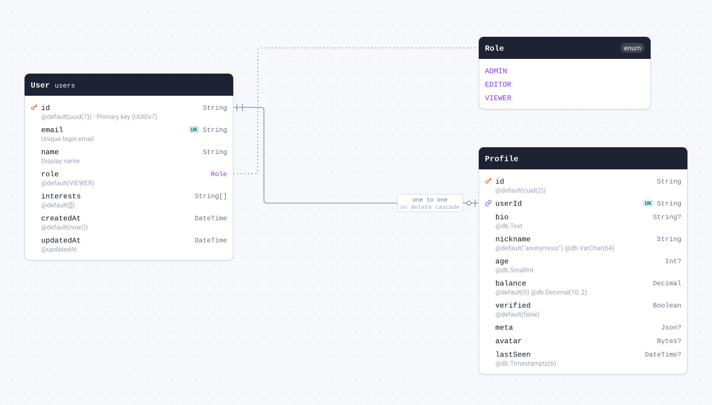

| Field                    | Type                            | Constraints                              | Default       | Description |
| ------------------------ | ------------------------------- | ---------------------------------------- | ------------- | ----------- |
| `id`                     | `String`                        | PK NOT NULL                              | `cuid(2)`     |             |
| `userId` (`user_id`)     | `String`                        | UNIQUE NOT NULL → [User.id](#model-User) |               |             |
| `bio`                    | `String` `@db.Text`             | NULL                                     |               |             |
| `nickname`               | `String` `@db.VarChar(64)`      | NOT NULL                                 | `"anonymous"` |             |
| `age`                    | `Int` `@db.SmallInt`            | NULL                                     |               |             |
| `balance`                | `Decimal` `@db.Decimal(10, 2)`  | NOT NULL                                 | `0`           |             |
| `verified`               | `Boolean`                       | NOT NULL                                 | `false`       |             |
| `meta`                   | `Json`                          | NULL                                     |               |             |
| `avatar`                 | `Bytes`                         | NULL                                     |               |             |
| `lastSeen` (`last_seen`) | `DateTime` `@db.Timestamptz(6)` | NULL                                     |               |             |

#### References

- `userId` → [User.id](#model-User) (one-to-one, on delete Cascade)

#### Definition

```sql
CREATE TABLE "Profile" (
    "id" TEXT NOT NULL,
    "user_id" TEXT NOT NULL,
    "bio" TEXT,
    "nickname" VARCHAR(64) NOT NULL DEFAULT 'anonymous',
    "age" SMALLINT,
    "balance" DECIMAL(10,2) NOT NULL DEFAULT 0,
    "verified" BOOLEAN NOT NULL DEFAULT false,
    "meta" JSONB,
    "avatar" BYTEA,
    "last_seen" TIMESTAMPTZ(6),

    CONSTRAINT "Profile_pkey" PRIMARY KEY ("id")
);

CREATE UNIQUE INDEX "Profile_user_id_key" ON "Profile"("user_id");

ALTER TABLE "Profile" ADD CONSTRAINT "Profile_user_id_fkey" FOREIGN KEY ("user_id") REFERENCES "users"("id") ON DELETE CASCADE ON UPDATE CASCADE;
```

<a id="model-Post"></a>

### Post

Table `posts`. @@map + @map column names, FK with a referential action,
mapped-enum default, and an implicit many-to-many to Tag.

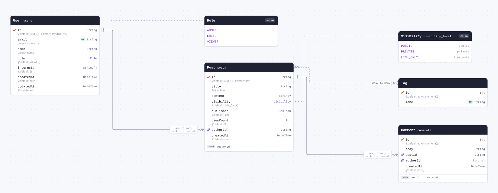

| Field                      | Type                             | Constraints                       | Default     | Description   |
| -------------------------- | -------------------------------- | --------------------------------- | ----------- | ------------- |
| `id`                       | `String`                         | PK NOT NULL                       | `uuid(4)`   | Primary key   |
| `title`                    | `String`                         | NOT NULL                          |             | Article title |
| `content`                  | `String`                         | NULL                              |             |               |
| `visibility`               | [`Visibility`](#enum-Visibility) | NOT NULL                          | `LINK_ONLY` |               |
| `published`                | `Boolean`                        | NOT NULL                          | `false`     |               |
| `viewCount` (`view_count`) | `Int`                            | NOT NULL                          | `0`         |               |
| `authorId` (`author_id`)   | `String`                         | NOT NULL → [User.id](#model-User) |             |               |
| `createdAt` (`created_at`) | `DateTime`                       | NOT NULL                          | `now()`     |               |

#### Indexes

- `@@index([authorId])`

#### References

- `authorId` → [User.id](#model-User) (many-to-one, on delete Cascade)

#### Referenced by

- `id` ← [Comment.postId](#model-Comment) (one-to-many, on delete Cascade)

#### Many to many

- `tags` ↔ [Tag.posts](#model-Tag) through `_PostToTag`

#### Definition

```sql
CREATE TABLE "posts" (
    "id" TEXT NOT NULL,
    "title" TEXT NOT NULL,
    "content" TEXT,
    "visibility" "visibility_level" NOT NULL DEFAULT 'link_only',
    "published" BOOLEAN NOT NULL DEFAULT false,
    "view_count" INTEGER NOT NULL DEFAULT 0,
    "author_id" TEXT NOT NULL,
    "created_at" TIMESTAMP(3) NOT NULL DEFAULT CURRENT_TIMESTAMP,

    CONSTRAINT "posts_pkey" PRIMARY KEY ("id")
);

CREATE INDEX "posts_author_id_idx" ON "posts"("author_id");

ALTER TABLE "posts" ADD CONSTRAINT "posts_author_id_fkey" FOREIGN KEY ("author_id") REFERENCES "users"("id") ON DELETE CASCADE ON UPDATE CASCADE;
```

<a id="model-Tag"></a>

### Tag

Implicit many-to-many partner of Post (join table `_PostToTag`).

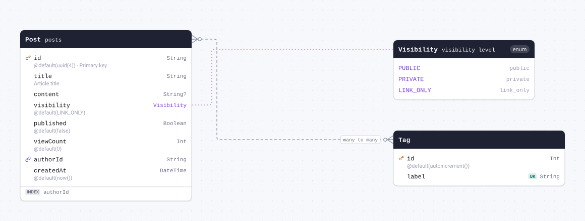

| Field   | Type     | Constraints     | Default           | Description |
| ------- | -------- | --------------- | ----------------- | ----------- |
| `id`    | `Int`    | PK NOT NULL     | `autoincrement()` |             |
| `label` | `String` | UNIQUE NOT NULL |                   |             |

#### Many to many

- `posts` ↔ [Post.tags](#model-Post) through `_PostToTag`

#### Definition

```sql
CREATE TABLE "Tag" (
    "id" SERIAL NOT NULL,
    "label" TEXT NOT NULL,

    CONSTRAINT "Tag_pkey" PRIMARY KEY ("id")
);

CREATE UNIQUE INDEX "Tag_label_key" ON "Tag"("label");
```

<a id="model-Comment"></a>

### Comment

Table `comments`. Two foreign keys with different referential actions
(Cascade vs SetNull) and a composite index.

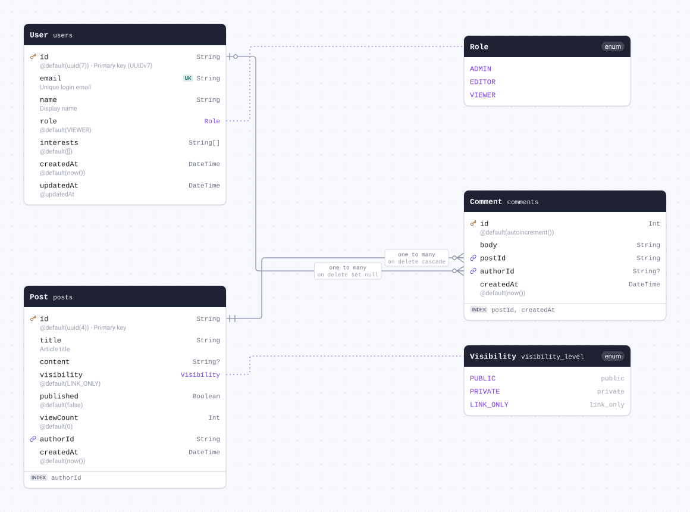

| Field                      | Type       | Constraints                       | Default           | Description |
| -------------------------- | ---------- | --------------------------------- | ----------------- | ----------- |
| `id`                       | `Int`      | PK NOT NULL                       | `autoincrement()` |             |
| `body`                     | `String`   | NOT NULL                          |                   |             |
| `postId` (`post_id`)       | `String`   | NOT NULL → [Post.id](#model-Post) |                   |             |
| `authorId` (`author_id`)   | `String`   | NULL → [User.id](#model-User)     |                   |             |
| `createdAt` (`created_at`) | `DateTime` | NOT NULL                          | `now()`           |             |

#### Indexes

- `@@index([postId, createdAt])`

#### References

- `postId` → [Post.id](#model-Post) (many-to-one, on delete Cascade)
- `authorId` → [User.id](#model-User) (many-to-one, on delete SetNull)

#### Definition

```sql
CREATE TABLE "comments" (
    "id" SERIAL NOT NULL,
    "body" TEXT NOT NULL,
    "post_id" TEXT NOT NULL,
    "author_id" TEXT,
    "created_at" TIMESTAMP(3) NOT NULL DEFAULT CURRENT_TIMESTAMP,

    CONSTRAINT "comments_pkey" PRIMARY KEY ("id")
);

CREATE INDEX "comments_post_id_created_at_idx" ON "comments"("post_id", "created_at");

ALTER TABLE "comments" ADD CONSTRAINT "comments_post_id_fkey" FOREIGN KEY ("post_id") REFERENCES "posts"("id") ON DELETE CASCADE ON UPDATE CASCADE;

ALTER TABLE "comments" ADD CONSTRAINT "comments_author_id_fkey" FOREIGN KEY ("author_id") REFERENCES "users"("id") ON DELETE SET NULL ON UPDATE CASCADE;
```

<a id="model-Follow"></a>

### Follow

Table `follows`. Composite primary key + two named relations to the same model.

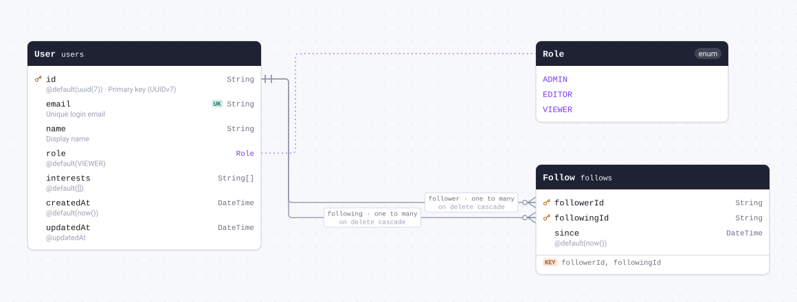

| Field                          | Type       | Constraints                          | Default | Description |
| ------------------------------ | ---------- | ------------------------------------ | ------- | ----------- |
| `followerId` (`follower_id`)   | `String`   | PK NOT NULL → [User.id](#model-User) |         |             |
| `followingId` (`following_id`) | `String`   | PK NOT NULL → [User.id](#model-User) |         |             |
| `since`                        | `DateTime` | NOT NULL                             | `now()` |             |

#### Indexes

- `@@id([followerId, followingId])`

#### References

- `followerId` → [User.id](#model-User) (many-to-one, on delete Cascade)
- `followingId` → [User.id](#model-User) (many-to-one, on delete Cascade)

#### Definition

```sql
CREATE TABLE "follows" (
    "follower_id" TEXT NOT NULL,
    "following_id" TEXT NOT NULL,
    "since" TIMESTAMP(3) NOT NULL DEFAULT CURRENT_TIMESTAMP,

    CONSTRAINT "follows_pkey" PRIMARY KEY ("follower_id","following_id")
);

ALTER TABLE "follows" ADD CONSTRAINT "follows_follower_id_fkey" FOREIGN KEY ("follower_id") REFERENCES "users"("id") ON DELETE CASCADE ON UPDATE CASCADE;

ALTER TABLE "follows" ADD CONSTRAINT "follows_following_id_fkey" FOREIGN KEY ("following_id") REFERENCES "users"("id") ON DELETE CASCADE ON UPDATE CASCADE;
```

<a id="model-Category"></a>

### Category

Self-relation (adjacency-list tree) with a composite unique.

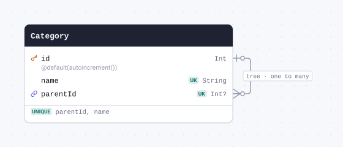

| Field                    | Type     | Constraints                           | Default           | Description |
| ------------------------ | -------- | ------------------------------------- | ----------------- | ----------- |
| `id`                     | `Int`    | PK NOT NULL                           | `autoincrement()` |             |
| `name`                   | `String` | NOT NULL                              |                   |             |
| `parentId` (`parent_id`) | `Int`    | NULL → [Category.id](#model-Category) |                   |             |

#### Indexes

- `@@unique([parentId, name])`

#### References

- `parentId` → [Category.id](#model-Category) (many-to-one)

#### Referenced by

- `id` ← [Category.parentId](#model-Category) (one-to-many)

#### Definition

```sql
CREATE TABLE "Category" (
    "id" SERIAL NOT NULL,
    "name" TEXT NOT NULL,
    "parent_id" INTEGER,

    CONSTRAINT "Category_pkey" PRIMARY KEY ("id")
);

CREATE UNIQUE INDEX "Category_parent_id_name_key" ON "Category"("parent_id", "name");

ALTER TABLE "Category" ADD CONSTRAINT "Category_parent_id_fkey" FOREIGN KEY ("parent_id") REFERENCES "Category"("id") ON DELETE SET NULL ON UPDATE CASCADE;
```

<a id="model-Order"></a>

### Order

Table `orders`. BigInt autoincrement primary key (bigserial) and money as Decimal.

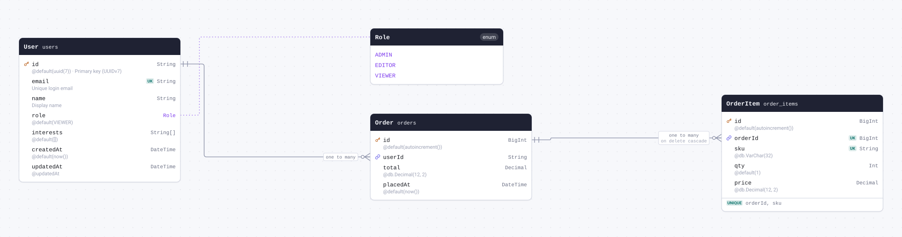

| Field                    | Type                           | Constraints                       | Default           | Description |
| ------------------------ | ------------------------------ | --------------------------------- | ----------------- | ----------- |
| `id`                     | `BigInt`                       | PK NOT NULL                       | `autoincrement()` |             |
| `userId` (`user_id`)     | `String`                       | NOT NULL → [User.id](#model-User) |                   |             |
| `total`                  | `Decimal` `@db.Decimal(12, 2)` | NOT NULL                          |                   |             |
| `placedAt` (`placed_at`) | `DateTime`                     | NOT NULL                          | `now()`           |             |

#### References

- `userId` → [User.id](#model-User) (many-to-one)

#### Referenced by

- `id` ← [OrderItem.orderId](#model-OrderItem) (one-to-many, on delete Cascade)

#### Definition

```sql
CREATE TABLE "orders" (
    "id" BIGSERIAL NOT NULL,
    "user_id" TEXT NOT NULL,
    "total" DECIMAL(12,2) NOT NULL,
    "placed_at" TIMESTAMP(3) NOT NULL DEFAULT CURRENT_TIMESTAMP,

    CONSTRAINT "orders_pkey" PRIMARY KEY ("id")
);

ALTER TABLE "orders" ADD CONSTRAINT "orders_user_id_fkey" FOREIGN KEY ("user_id") REFERENCES "users"("id") ON DELETE RESTRICT ON UPDATE CASCADE;
```

<a id="model-OrderItem"></a>

### OrderItem

Table `order_items`. Child of Order with a composite unique constraint.

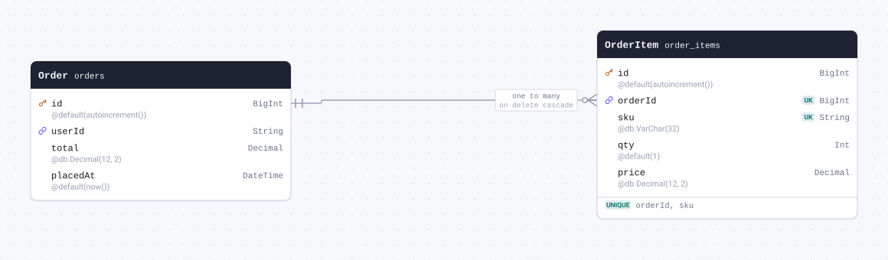

| Field                  | Type                           | Constraints                         | Default           | Description |
| ---------------------- | ------------------------------ | ----------------------------------- | ----------------- | ----------- |
| `id`                   | `BigInt`                       | PK NOT NULL                         | `autoincrement()` |             |
| `orderId` (`order_id`) | `BigInt`                       | NOT NULL → [Order.id](#model-Order) |                   |             |
| `sku`                  | `String` `@db.VarChar(32)`     | NOT NULL                            |                   |             |
| `qty`                  | `Int`                          | NOT NULL                            | `1`               |             |
| `price`                | `Decimal` `@db.Decimal(12, 2)` | NOT NULL                            |                   |             |

#### Indexes

- `@@unique([orderId, sku])`

#### References

- `orderId` → [Order.id](#model-Order) (many-to-one, on delete Cascade)

#### Definition

```sql
CREATE TABLE "order_items" (
    "id" BIGSERIAL NOT NULL,
    "order_id" BIGINT NOT NULL,
    "sku" VARCHAR(32) NOT NULL,
    "qty" INTEGER NOT NULL DEFAULT 1,
    "price" DECIMAL(12,2) NOT NULL,

    CONSTRAINT "order_items_pkey" PRIMARY KEY ("id")
);

CREATE UNIQUE INDEX "order_items_order_id_sku_key" ON "order_items"("order_id", "sku");

ALTER TABLE "order_items" ADD CONSTRAINT "order_items_order_id_fkey" FOREIGN KEY ("order_id") REFERENCES "orders"("id") ON DELETE CASCADE ON UPDATE CASCADE;
```

<a id="model-AuditLog"></a>

### AuditLog

Table `audit_logs`. DB-side generated defaults (dbgenerated) plus Json / Bytes payloads.

| Field                    | Type                | Constraints | Default                            | Description |
| ------------------------ | ------------------- | ----------- | ---------------------------------- | ----------- |
| `id`                     | `String` `@db.Uuid` | PK NOT NULL | `dbgenerated("gen_random_uuid()")` |             |
| `action`                 | `String`            | NOT NULL    |                                    |             |
| `payload`                | `Json`              | NOT NULL    | `"{}"`                             |             |
| `signature`              | `Bytes`             | NULL        |                                    |             |
| `loggedAt` (`logged_at`) | `DateTime`          | NOT NULL    | `dbgenerated("now()")`             |             |

#### Definition

```sql
CREATE TABLE "audit_logs" (
    "id" UUID NOT NULL DEFAULT gen_random_uuid(),
    "action" TEXT NOT NULL,
    "payload" JSONB NOT NULL DEFAULT '{}',
    "signature" BYTEA,
    "logged_at" TIMESTAMP(3) NOT NULL DEFAULT now(),

    CONSTRAINT "audit_logs_pkey" PRIMARY KEY ("id")
);
```

<a id="model-Actor"></a>

### Actor

Named implicit many-to-many: the join table is `_cast`,
not `_ActorToFilm`.

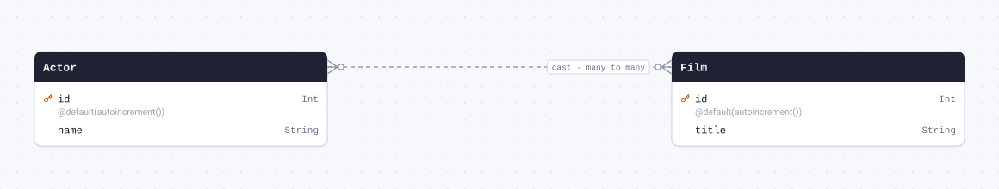

| Field  | Type     | Constraints | Default           | Description |
| ------ | -------- | ----------- | ----------------- | ----------- |
| `id`   | `Int`    | PK NOT NULL | `autoincrement()` |             |
| `name` | `String` | NOT NULL    |                   |             |

#### Many to many

- `films` ↔ [Film.actors](#model-Film) through `_cast`

#### Definition

```sql
CREATE TABLE "Actor" (
    "id" SERIAL NOT NULL,
    "name" TEXT NOT NULL,

    CONSTRAINT "Actor_pkey" PRIMARY KEY ("id")
);
```

<a id="model-Film"></a>

### Film


| Field   | Type     | Constraints | Default           | Description |
| ------- | -------- | ----------- | ----------------- | ----------- |
| `id`    | `Int`    | PK NOT NULL | `autoincrement()` |             |
| `title` | `String` | NOT NULL    |                   |             |

#### Many to many

- `actors` ↔ [Actor.films](#model-Actor) through `_cast`

#### Definition

```sql
CREATE TABLE "Film" (
    "id" SERIAL NOT NULL,
    "title" TEXT NOT NULL,

    CONSTRAINT "Film_pkey" PRIMARY KEY ("id")
);
```

## Enums

<a id="enum-Role"></a>

### Role

User role. No @map: the value names are stored verbatim.

- `ADMIN`
- `EDITOR`
- `VIEWER`

#### Definition

```sql
CREATE TYPE "Role" AS ENUM ('ADMIN', 'EDITOR', 'VIEWER');
```

<a id="enum-Visibility"></a>

### Visibility

Type `visibility_level`. Enum with @map on every value and @@map on the enum itself:
the database stores the mapped values ("link_only"), while
generators receive the Prisma-level names ("LINK_ONLY").

- `PUBLIC` (`public`)
- `PRIVATE` (`private`)
- `LINK_ONLY` (`link_only`)

#### Definition

```sql
CREATE TYPE "visibility_level" AS ENUM ('public', 'private', 'link_only');
```
